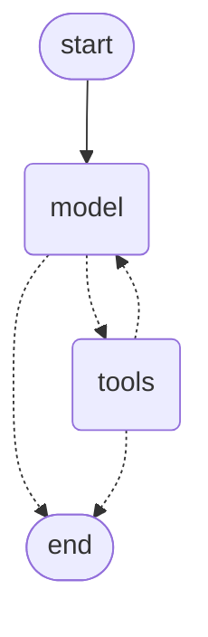
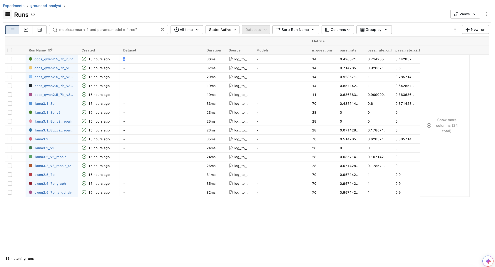

# Grounded Analyst

An LLM agent that answers questions about building electricity forecasts and
has to prove its numbers. It calls a forecast API (from my
[building-energy-forecast](https://github.com/Vaishnavi-Marihal/building-energy-forecast)
project), a calculator and a document search over that project's README. A
checker compares every number in the answer with what the tools returned and
flags any number that no tool produced.

## Architecture



- **Agent:** a LangGraph graph with a `model` node and a `tools` node. The model
  call uses LangChain's `ChatOllama`. The tool functions are my own, because the
  grounding rules (for example, the calculator only accepts numbers that came
  from earlier tool results) live in them.
- **Tools:** forecast summary for a building and date, building metrics, a
  calculator (`subtract`, `percent_difference`) and `search_docs`.
- **Search:** README split into chunks, embedded with `nomic-embed-text`;
  hybrid search = dense ranking + BM25, merged by reciprocal rank fusion.
- **Checker:** `checker.py`. Numbers in the answer must match a tool result
  after rounding to the same number of decimals. Dates and clock times are
  ignored.
- The same agent exists as a plain loop, as a LangGraph graph and as the
  LangChain version. All three gave identical answers on all 70 questions
  (Qwen 2.5 7B).

## Results

70 questions generated from the forecast API (12 totals and peaks, 12 gaps
from the actual, 8 percentages, 8 baseline comparisons, 8 false-premise,
8 two-building, 8 unanswerable, 6 metrics). Ground truth comes from the API,
not from a model. Model runs use temperature 0 and a recorded cache of API
responses, so a rerun gives the same results.

| Model (via Ollama) | Passed | 95% interval |
|---|---|---|
| qwen2.5:7b | 67/70 | 90-100% |
| llama3.1:8b | 34/70 | 37-60% |
| llama3.2 (3B) | 36/70 | 39-63% |



What I found:

1. **Qwen vs the two Llama models is a real difference** (intervals do not
   overlap). Llama 8B vs 3B is not (34 vs 36 of 70).
2. **Both Llama models scored 0/28 on the questions that need two tool calls**
   (fetch a forecast, then call the calculator). A clearer prompt, running tool
   calls the model had written as plain text, and a more forgiving tool
   interface (accepting numbers as strings, naming valid operations in errors,
   more steps) moved this to at most 2/28. This is for this prompt and these
   tool definitions through Ollama. It is not a statement about the models in
   general.
3. **Document questions (RAG).** 14 questions about the project README went
   from 6/14 to 10/14 (a prompt telling the model when to search) to 13/14
   (hybrid search). I chose those changes after seeing those 14 questions, so I
   then wrote 11 new questions and ran them once with the setup frozen: **7/11**
   (interval 36-91%). The 13/14 figure is optimistic.
4. **Hybrid search vs dense search.** On the first set the right paragraph was
   in the top 3 for 11/12 questions (dense: 9/12), and on the held-out set for
   9/9 (dense: 6/9). It did **not** reliably put the right paragraph first
   (held-out: 4/9 vs 5/9). The agent sees the top 3, so top-3 coverage is what
   matters here.

## What the checker cannot do

- It catches numbers nobody retrieved. It does not catch a real number used for
  the wrong thing: Qwen once answered with numbers fetched for the wrong date.
- It ignores direction. "2.8% lower" and "2.8% higher" are the same to it.
- It is literal about units. A held-out answer that wrote 0.80 as "80%" and
  another that added "about 7 days" for 168 hours were correct but failed.
  I did not change the checker after seeing those results (see `EVAL_NOTES.md`).
- Every number inside retrieved text counts as allowed, so document questions
  get a weaker check. Qwen once mixed a ratio with a coverage figure from the
  same paragraph and the checker passed it. Document questions therefore have
  hand-written gold numbers, and any other decimal fails.
- Small test sets written by one person. The intervals treat questions as
  independent although many share buildings and failure types, so they are
  somewhat too narrow. I changed the document answer key three times after
  seeing results (logged in `EVAL_NOTES.md`).

## Reproduce

Needs Python 3.12 and [Ollama](https://ollama.com).

```bash
python3.12 -m venv .venv && source .venv/bin/activate
pip install -r requirements.txt
ollama pull qwen2.5:7b && ollama pull nomic-embed-text
python rag.py build
pytest
FORECAST_MODE=auto python eval.py qwen2.5:7b          # uses the recorded API responses, calls the API only for new requests
python log_to_mlflow.py && mlflow ui --backend-store-uri sqlite:///mlflow.db
```

`FORECAST_MODE=replay` runs fully offline but fails on any request that was not recorded. `FORECAST_MODE=live` always calls the forecast API (`FORECAST_API_URL`, default is my demo server).

## Layout

`agent.py` plain loop and prompts · `graph_agent.py` LangGraph ·
`langchain_agent.py` LangChain version · `tools.py` · `checker.py` ·
`rag.py` search · `retrieval_eval.py` · `eval.py`, `eval_docs.py`,
`questions.py` · `docs_questions.json`, `held_out_questions.json` ·
`log_to_mlflow.py` · `cache/` recorded API responses · `results/` ·
`EVAL_NOTES.md`

## Data and licence

The forecasts come from a model trained on the Building Data Genome Project 2 (Miller et al., Sci Data 7, 368, 2020, https://doi.org/10.1038/s41597-020-00712-x), which is shared under CC BY-SA 4.0. The files in `cache/` and the tool results stored in `results/` contain forecasts and aggregated readings derived from it, and are shared under **CC BY-SA 4.0** too (see `cache/NOTICE.md`). The source code is under the **MIT licence** (see `LICENSE`).
